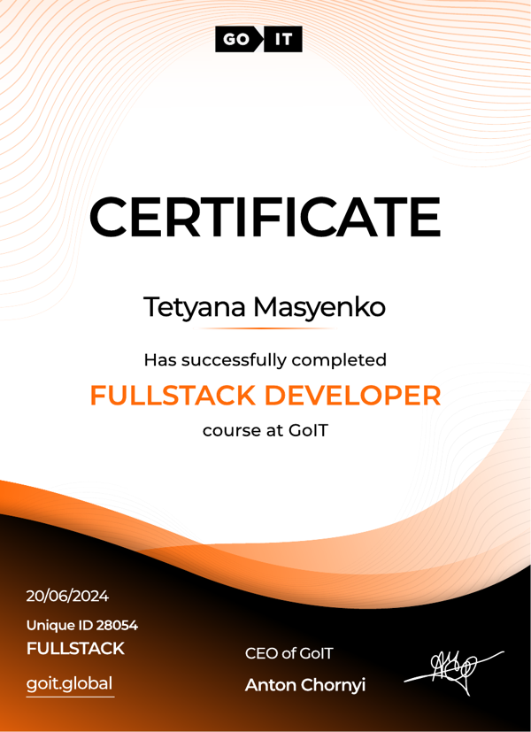

  

## 👩‍💻 About me

I am a **Fullstack Developer** based in the Czech Republic. I build responsive
websites and web applications with **HTML, CSS, JavaScript, React and Node.js** —
from landing pages for small businesses to React apps with Redux, REST API and
MongoDB. I take care of clean code, adaptive layout and deployment.

- 🌍 Languages: 🇺🇦 Ukrainian — native · Russian — native · 🇨🇿 Czech — B1 · 🇬🇧 English — A2
- 📫 Email: **masyenko@gmail.com**
- 📄 Resume: **[masenko2604.github.io/resume](https://masenko2604.github.io/resume/)**
- 💼 Portfolio: **[my-portfolio-mauve-rho-98.vercel.app](https://my-portfolio-mauve-rho-98.vercel.app)**

## 🎓 Education

**Fullstack Developer** — [GoIT](https://goit.global), June 2024 
HTML + CSS · JavaScript · React + Redux · Node.js + Express + MongoDB · TypeScript · 3 team projects

## 🚀 Featured projects

| Project | Description | Stack | Links |
| --- | --- | --- | --- |
| **GreenFrog Office** | Business website for an accounting and admin services company in Czechia | HTML, CSS, JavaScript | [Live](https://greenfrogoffice.cz) |
| **TaskPro** | Trello-style task manager: boards, columns, cards, themes, auth. Team project — my part: Welcome page | React, Redux Toolkit, React Router, Formik | [Live](https://react-task-pro-seven.vercel.app) · [Code](https://github.com/Masenko2604/react-task-pro) |
| **Food Boutique** | Online store of organic food: filters, cart, checkout. Team project — my part: pagination | JavaScript, Vite, Axios, REST API | [Live](https://masenko2604.github.io/fson-95-project-team_2/) · [Code](https://github.com/Masenko2604/fson-95-project-team_2) |
| **Magic of Photography** | Landing page for a photography school. Team project — my part: header | HTML, CSS, JavaScript, Vite | [Live](https://magic-of-photography.vercel.app) · [Code](https://github.com/Masenko2604/magic-of-photography) |

## 🛠 Languages and Tools

## 📊 Statistics

  
  

